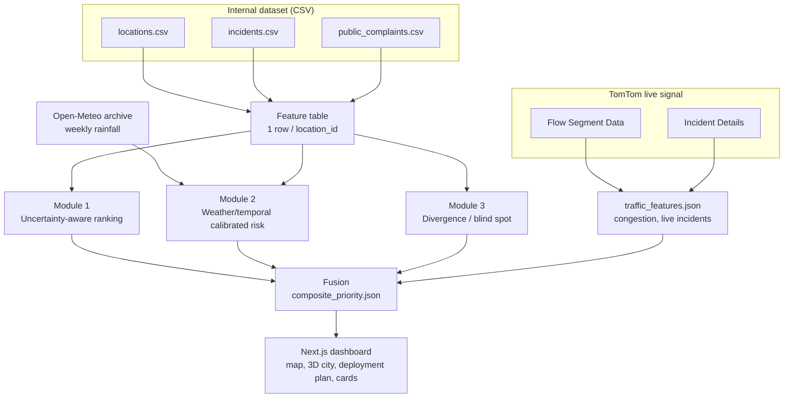

# Smart City: Where Should We Fix First?

An explainable road-safety priority product for Vijayawada and Amaravati. It fuses a
historical municipal dataset with a live TomTom traffic signal across three differentiated
ML modules, then ranks every location into one queue where **each number carries a
plain-English reason**.

Core idea: TomTom does not replace the dataset. It adds a live, present-day signal (current
congestion, active incidents) on top of the historical signal (past incidents and
complaints). The gap between "historically risky" and "currently congested right now" is
itself a feature.

## Architecture



## Data sources

| Source | Grain | What it gives you |
| --- | --- | --- |
| `locations.csv` | 1 row / location | zone, road_type, road_condition, population_density, near_school, near_hospital, pedestrian_activity, lat/long |
| `incidents.csv` | 1 row / incident | type, severity, injuries, resolved, resolution_hours, timestamp |
| `public_complaints.csv` | 1 row / complaint | category, priority_reported, status, days_to_resolution, created_at |
| TomTom Flow Segment Data | live, per coordinate | currentSpeed, freeFlowSpeed, confidence, road class (frc), roadClosure |
| TomTom Incident Details | live, per bounding box | active incidents near a point now: count and magnitude of delay |
| Open-Meteo archive | daily, per city | historical precipitation for Vijayawada (free, no key) |

## The three modules

| Module | Question | Method | Output |
| --- | --- | --- | --- |
| 1: Uncertainty-aware ranking | How urgent, and how sure are we? | three quantile Gradient Boosting regressors (5th / 50th / 95th percentile) give a priority band, not a point score | `module1_priority.json` |
| 2: Weather/temporal calibrated risk | What is the chance of a severe incident next week? | Random Forest on a `(location, week)` panel with real weekly rainfall, then isotonic `CalibratedClassifierCV`; time-aware + rolling-origin validation | `module2_risk.json` |
| 3: Divergence / blind spot | Where do citizens and the record disagree? | per-location z-scored complaints minus z-scored incidents | `module3_divergence.json` |

Module 3 is kept as a **separate** investigate list in the product, so a data gap never
silently inflates urgency.

## TomTom API reference

Only two endpoints are used.

| Endpoint | Call | Derived feature |
| --- | --- | --- |
| Flow Segment Data | `GET /traffic/services/4/flowSegmentData/absolute/10/json?point={lat},{lon}&unit=KMPH&key=` | `congestion_ratio = currentSpeed / freeFlowSpeed` (0 = jammed, 1 = free-flow) |
| Incident Details | `GET /traffic/services/5/incidentDetails?bbox={minLon},{minLat},{maxLon},{maxLat}&fields=...&key=` | `live_incident_count`, `max_live_delay` within a ~300 m box |


## Fusion

The composite score standardizes the historical priority (Module 1) and the forward risk
(Module 2) so neither dominates by scale, then adds a small live-congestion nudge:

| Signal | Weight |
| --- | --- |
| Module 1 priority (z-scored) | 0.5 |
| Module 2 risk (z-scored) | 0.4 |
| Live jam factor `1 - congestion_ratio` | 0.1 |

Module 3 rides alongside as a flag, not a term in the score.

## Repository layout

| Path | What |
| --- | --- |
| `dataset/` | the three source CSVs |
| `notebooks/module-1.ipynb` | Module 1: uncertainty-aware ranking |
| `notebooks/module-2.ipynb` | Module 2: weather/temporal calibrated risk |
| `notebooks/module-3.ipynb` | Module 3: divergence / blind spot |
| `notebooks/traffic_features.ipynb` | TomTom Flow + Incident Details enrichment |
| `notebooks/fusion.ipynb` | joins all modules into the composite queue |
| `frontend/` | Next.js dashboard (map, 3D city, deployment planner, cards) |
| `frontend/public/data/` | the exported JSON the dashboard reads |

## Running it

### Notebooks (Python 3, pandas + scikit-learn)

Run in order from inside `notebooks/`:

1. `module-1.ipynb` → `module1_priority.json`
2. `module-2.ipynb` → `module2_risk.json` (fetches rainfall from Open-Meteo)
3. `module-3.ipynb` → `module3_divergence.json`
4. `traffic_features.ipynb` → `traffic_features.json` (needs a TomTom key, set in the notebook)
5. `fusion.ipynb` → `composite_priority.json`

Copy the exported JSON into `frontend/public/data/` for the dashboard to pick it up.

### Frontend

```bash
cd frontend
npm install
npm run dev     # http://localhost:3000
npm run build   # production build
```

No environment variables are required to run the dashboard: it reads the pre-generated JSON
files and uses OpenStreetMap tiles plus OSRM for routing, none of which need a key. The
TomTom key is only used offline inside `traffic_features.ipynb`.

## Validation notes

- **Time-aware splits only.** Module 2 trains on the earlier weeks and tests on the most
  recent weeks (no random shuffle), plus a rolling-origin walk-forward check.
- **Calibration is reported.** Module 2 prints Brier score before and after isotonic
  calibration, with a reliability table.
- **Honest about this dataset.** The synthetic data has a flat ~0.40 severe-incident rate
  across every road condition, type and month, so Module 2's ranking AUC sits near chance.
  The deliverable is the correct, calibrated methodology; point it at data with real signal
  and the lift rises automatically.

## Frontend components

The dashboard is split into focused files under `frontend/app/`:

| Path | Role |
| --- | --- |
| `lib/types.ts` | shared TypeScript types |
| `lib/theme.ts` | colors, tiers, and the plain-English helpers |
| `lib/cdn.ts` | Leaflet / Three.js CDN loaders and map tiles |
| `lib/tsp.ts` | geometry, k-means, and the nearest-neighbour + 2-opt route solver |
| `components/MapView.tsx` | priority map |
| `components/City3D.tsx` | 3D city hero (tower height = priority) |
| `components/DeployMap.tsx` | crew deployment planner with animated routes |
| `components/BandChart.tsx` | Module 1 priority bands chart |
| `components/FusedQueue.tsx` | Section 8 explainable cards |
| `components/LocationCard.tsx` | per-location summary popup |
| `components/ui.tsx`, `components/icons.tsx` | shared primitives |
| `page.tsx` | data loading and page layout |

